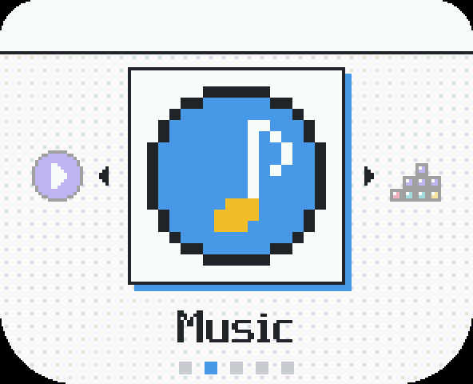
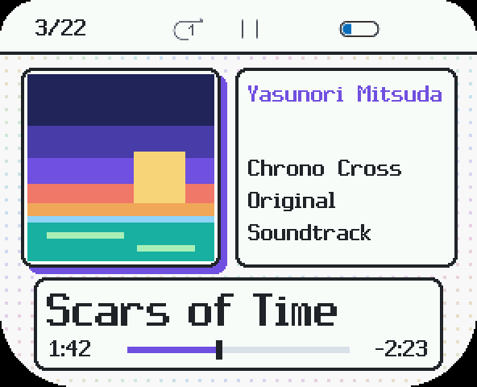
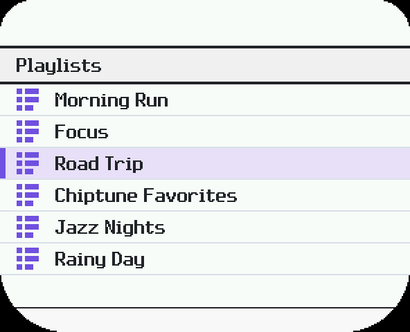
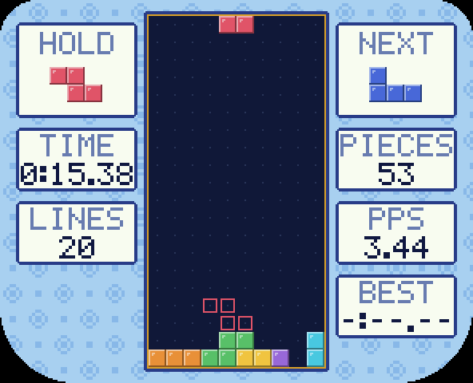

> **This folder is a fork.** It started as [amuletOS](https://github.com/dharma-dingo/amuletOS) v0.3 by dharma-dingo
> (commit `02f33f9`, MIT licence, see [LICENSE](LICENSE)) and is being developed separately: rebased onto Hidizs's
> V1.8.3 firmware and extended as described in [PLAN.md](PLAN.md). It is not affiliated with amuletOS or Hidizs.
> The text below is amuletOS's own README, kept for reference.

# amuletOS

Custom firmware for the **Hidizs AP30** music player. It keeps the stock audio engine (every format, hi-res,
the stock sound) and replaces how the player looks and gets around: a clean Game Boy Pocket style, a one-level
menu, a new Now Playing screen, playlists, a block game and an experimental Game Boy emulator.

**Current release: v0.3** (see [CHANGELOG.md](CHANGELOG.md)).

| | |
|---|---|
|  |  |
| Main menu | Now Playing |
|  |  |
| Playlists | Blockz |

Rendered on a PC from the firmware's own art, fonts and drawing code, with sample content
(`art/readme_shots.py`).

## What you get in v0.3

- **New look:** a light Pocket-style interface with a new font, applied to every screen.
- **One-level main menu:** Now Playing, Music, Blockz, Games, Library. Left / Right move, Start opens Settings.
  The player starts on Music; Now Playing is greyed out until something plays.
- **Now Playing:** big scrolling title, artist and album, cover art, progress bar, elapsed / remaining time,
  track n of total. B goes back to the main menu.
- **Playlists:** `.m3u` / `.m3u8` files in `/_Playlists/` on the SD card, under Music → Playlists.
- **Library:** no rescan at boot when the card hasn't changed; Music → Update rebuilds it on demand.
- **Settings survive firmware updates**, and the menus stay in English.
- **Blockz:** a block game with hard drop, ghost piece and hold (volume wheel). It keeps your music playing, or
  shuffles tracks from `/_blockgame/` on the SD card.
- **Games (experimental):** a Game Boy emulator for original Game Boy games (`.gb` files in `/_gb/` on the SD
  card), full screen with a DMG-style LCD look and sound, plus the built-in games still in the firmware.
  No saves yet, no Game Boy Color. Hold Select to quit a game.

## Install

**Full walkthrough, including where to put playlists, Blockz music and games on the SD card:
[docs/SETUP.md](docs/SETUP.md).** No special button combination is needed: the AP30 updates from a file copied
over USB.

You need the official AP30 firmware **V1.7.8** (`HIFIYF18.IMG`) from the
[Hidizs download center](https://hidizs.net/pages/download-center). amuletOS is applied to your own copy of it,
so no Hidizs firmware is shared here.

1. Download the patcher from the [latest release](../../releases/latest):
   `amuletOS-0.3-patcher.html` (any browser, works offline) or `amuletos_patch.py` (Python 3.8+).
2. **Browser:** open the HTML file, keep "Install amuletOS" selected, choose `HIFIYF18.IMG`, then save the result.
   **Python:** `python amuletos_patch.py HIFIYF18.IMG` writes `amuletOS-0.3/HIFIYF18.IMG`.
3. Connect the AP30 by USB, copy the new `HIFIYF18.IMG` to its **internal storage** (not the SD card), eject it
   and unplug. The player installs the update and restarts. Charge the battery first: low battery stops updates.

### SD card at a glance

The card must be **exFAT** for Playlists and Games (cards of 64 GB and up usually are). Folder names ignore case.

| Folder | What goes in it |
|---|---|
| anywhere | your music (Artist / Album folders with tags work best) |
| `/_Playlists/` | `.m3u` / `.m3u8` playlists (up to 24, first 24 tracks of each) |
| `/_blockgame/` | audio files Blockz shuffles when nothing else is playing |
| `/_gb/` | original Game Boy `.gb` games (up to 24, 2 MB each) |

The patcher refuses any file except the official V1.7.8, and only saves a result whose SHA-256 matches the
amuletOS release:

| File | SHA-256 |
|---|---|
| Official V1.7.8 `HIFIYF18.IMG` (input) | `c7601873cb3be8d1320225c69669e504576f7bcb1126595a9040492338e79840` |
| amuletOS 0.3 `HIFIYF18.IMG` (output) | `3cfeeac763c057c650cc044ef41f279572d00885bc1a0e2c31743136a2e904e5` |

## Go back to the official firmware

The AP30 only installs a file stamped newer than the firmware it is running, so the official file can't be copied
over amuletOS as it is. In the patcher choose "Go back to the official firmware" (or run
`python amuletos_patch.py --stock HIFIYF18.IMG`): it gives your official file a newer stamp and the matching
checksum and changes nothing else. Copy the result to the internal storage as above. To return to amuletOS after
that, use a later amuletOS release (v0.3 is older than the re-stamped file).

## Known limits

- Starting playback and some stock screens are still as slow as stock; speed is the focus of v0.4.
- The Game Boy emulator has no saves and runs original Game Boy games only; heavy games may drop frames.
- Library, Folders and the other stock lists are still stock screens in the new colours.

## Building from source

Developers: the build needs the official firmware in `firmware/` (never commit it) and the Arm GNU Toolchain.
`build/b60.sh` builds the v0.3 image; `tools/make_patch.py` makes the patchers from the official file and a build.
Notes on the hardware and the firmware are in [docs/HARDWARE.md](docs/HARDWARE.md); the build history is in
[docs/HANDOFF.md](docs/HANDOFF.md) and [docs/DEVLOG.md](docs/DEVLOG.md).

## License and credits

amuletOS's own code, art and font are under the [MIT License](LICENSE). It bundles
[Peanut-GB](https://github.com/deltabeard/Peanut-GB) and minigb_apu (both MIT); see
[THIRD_PARTY_NOTICES.md](THIRD_PARTY_NOTICES.md).

amuletOS is an independent project, not made by or affiliated with Hidizs. It contains no Hidizs firmware: the
patcher reads your own copy of the official file. Installing custom firmware is at your own risk and may affect
your warranty.
